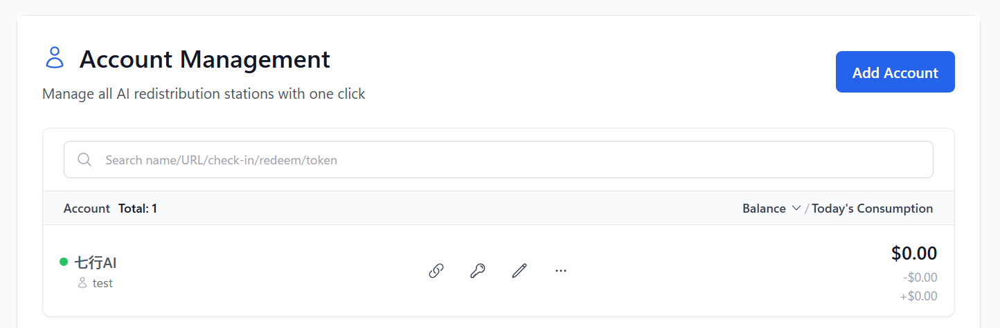
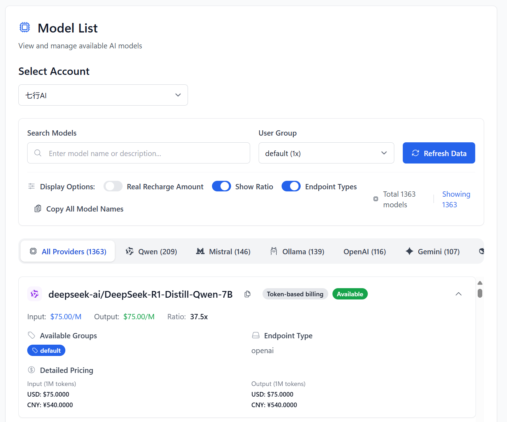
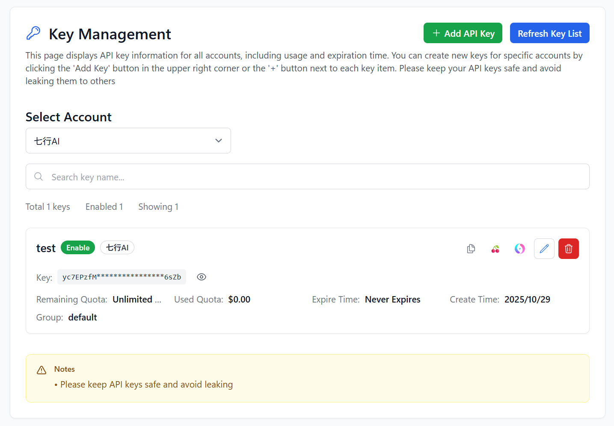
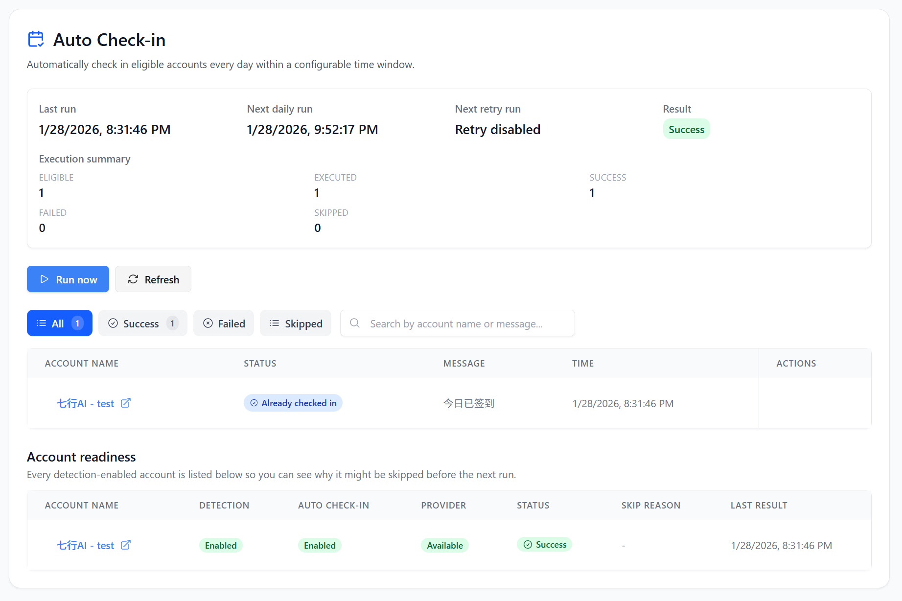
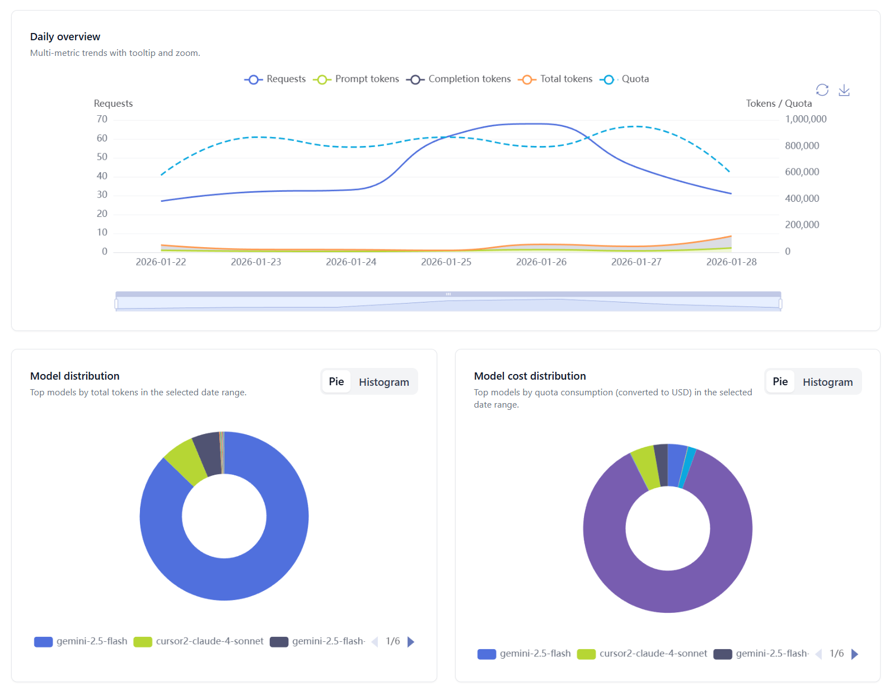
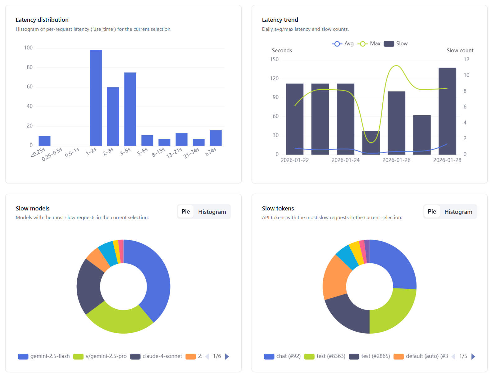
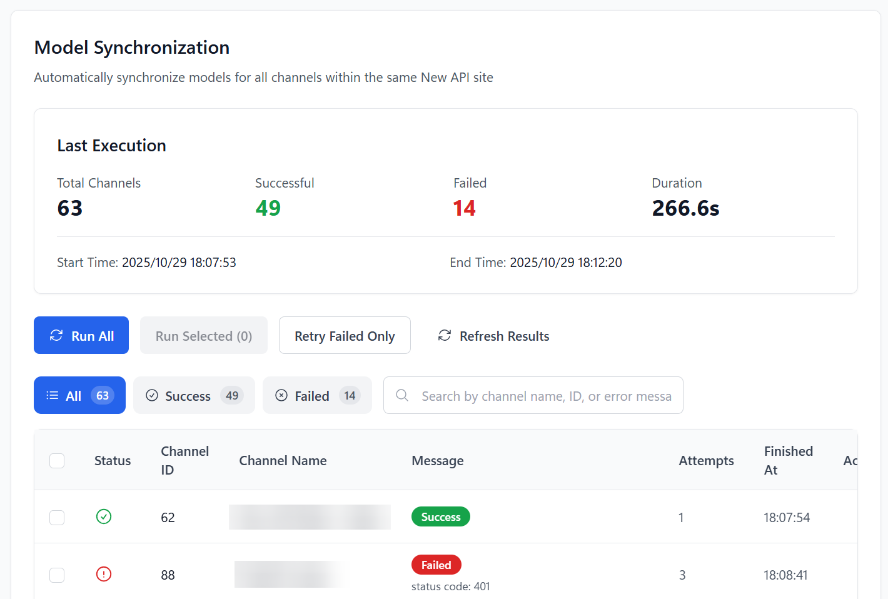
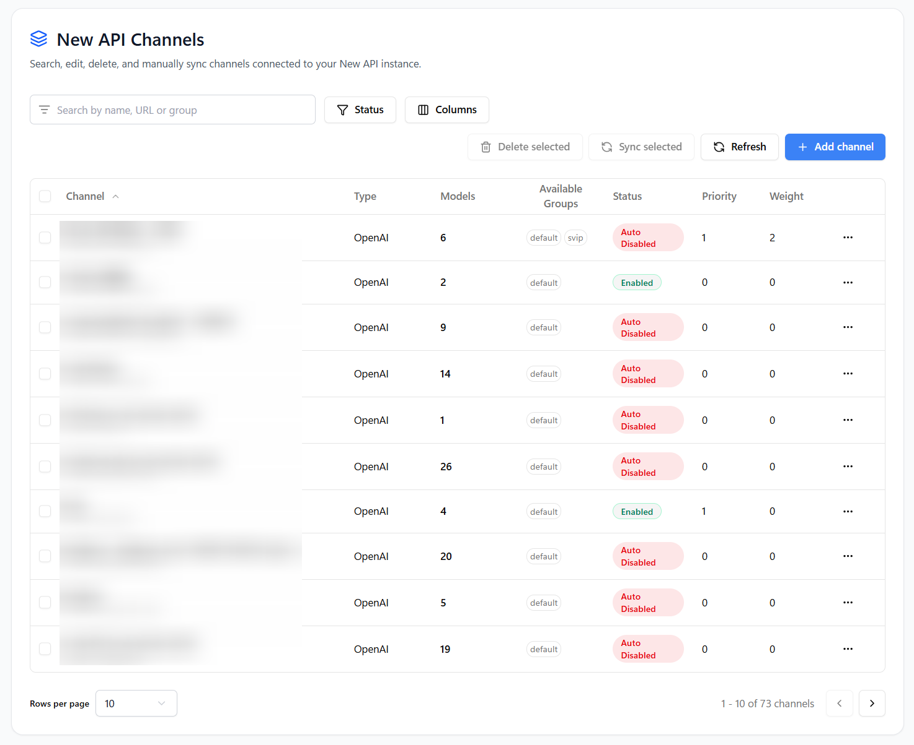

<h4 align="center">
<a href="./README_CN.md">简体中文</a> | English | <a href="./README_JA.md">日本語</a>
</h4>

# My API Box – Your All-in-One AI Asset Manager

> Based on [all-api-hub](https://github.com/qixing-jk/all-api-hub) (AGPL-3.0), rebranded and modified as **My API Box**. Source is open under the same license; see LICENSE and THIRD_PARTY_NOTICES.md.

**One-stop management for New API-compatible relay accounts: balances, usage, model prices, check-ins, API credentials, in-page testing, and channel/model sync & redirects**

## ❓ Why My API Box?

**In simple terms**: AI relay sites are like a marketplace for AI credits, giving you low-cost or even free access to models such as ChatGPT, Claude, and GPT Image.

But once you have multiple accounts, management quickly becomes painful:

- 📂 **Scattered assets**: Balances and usage are spread across separate sites.
- 💲 **Messy pricing**: Different billing ratios make the best deal hard to spot.
- ✅ **Missed daily perks**: Manual daily check-ins are easy to forget.
- 🔌 **Annoying setup work**: API details must be copied into tools such as cc-switch and Cherry Studio again and again.

**My API Box is your AI asset manager**: add your site URLs and let the extension handle the rest.

## ✨ What Can It Do for You?

### 📊 All Your AI Assets in One View

- **Unified Relay Account Dashboard**: Manage multiple AI relay accounts in one place and review balances, usage, and account status without signing in to each site.
- **API Credential Library**: No site account required—bring Base URLs and API Keys shared by others or collected over time together, then check balances, view models, test connections, or export whenever needed.
- **Usage & Trend Analytics**: Track balance changes and view charts by site, account, and model to understand where your credits go.

### 💰 Price Comparison & Auto Check-In

- **Cross-Site Model Price Comparison**: Compare the effective price of the same model across sites and quickly find a better-value endpoint.
- **Multi-Site Auto Check-In**: Check in to supported sites with one click or on a schedule, collect rewards automatically, and skip daily logins.

### 🚀 Quick Capture & Client Integration

- **Quick Web Capture**: Find Base URLs and API Keys on a page, test them immediately, and save them to your credential library with less copying and tab switching.
- **One-Click Client Export**: Send credentials to CC Switch, Cherry Studio, Claude Code Router, Kilo Code, Roo Code, Kelivo, AI Toolbox, Cursor++, and other supported export tools.

### 🧪 API Verification & Troubleshooting

- **API & Model Verification**: Check API connectivity and model availability in one click to see whether a Key works and a model can be called.
- **CLI Integration Testing**: Confirm that common command-line tools can use the target API before you spend time troubleshooting a full setup.

### 🔔 Announcements & Task Alerts

- **Announcements in One Place**: Automatically collect and display announcements from added sites in one place, with timely alerts for maintenance, model, pricing, and other updates—no need to check sites one by one.
- **Task Result Alerts**: After automated check-ins, WebDAV auto-sync, or model sync completes, receive the result through your browser or a configured notification method so failures and exceptions can be handled promptly.

### 🛠️ Self-Hosted AI Gateway Management

- **Manage Popular AI Gateways in One Place**: Manage OmniRoute, CLIProxyAPI, New API, Sub2API, Magpie, gpt-load, AxonHub, Claude Code Hub, Octopus, Veloera, and DoneHub directly in the extension without opening each admin panel.
- **Quickly Create Gateway Channels**: Turn saved site accounts or credentials from the API Credential Library into self-hosted AI gateway channels, then call models through the gateway and switch between channels as needed.
- **Model Sync & Redirects**: On supported sites, sync channel model lists manually or automatically on a schedule as upstream models change, and define custom redirects so clients can use the model names they prefer.

### 🔐 Data Security & Cloud Sync

- **Local-First Storage**: API Keys, accounts, and settings stay in your browser by default and are written to WebDAV only when you enable backup or sync.
- **Encrypted WebDAV Auto-Sync**: Enable encryption and scheduled auto-sync to keep data safely synchronized across devices and pick up where you left off after switching computers.

## 🚀 Quick Installation

> [!IMPORTANT] > **For most users, the store build is recommended.** It is easy to install and supports automatic updates.

| Channel          | Install Link                                                                                       | Current Version                                                                                                                                                                                                                                                                                                                           | Users                                                                                                                                                                                                                                                                                                         |
| ---------------- | -------------------------------------------------------------------------------------------------- | ----------------------------------------------------------------------------------------------------------------------------------------------------------------------------------------------------------------------------------------------------------------------------------------------------------------------------------------- | ------------------------------------------------------------------------------------------------------------------------------------------------------------------------------------------------------------------------------------------------------------------------------------------------------------- |
| Store listings | To be added after store publication | — |

📦 Need manual installation or Nightly builds? (Click to expand)

| Channel             | Download Link                                                                     | Best For                                                                                            |
| ------------------- | --------------------------------------------------------------------------------- | --------------------------------------------------------------------------------------------------- |
| GitHub Stable       | [Download Stable](https://github.com/jinchaoqiang0311/my-api-box/releases/latest)       | When you cannot install the store build or need to temporarily install a published fix manually     |
| Nightly pre-release | [Download Nightly](https://github.com/jinchaoqiang0311/my-api-box/releases/tag/nightly) | When you want early access and are willing to help test; it may be less stable than the store build |

GitHub Stable and Nightly are manual installation channels and do not auto-update. Star / Watch the repository to receive new version notifications. See the installation and update guide for more details.

**Other environments:**

- **Mobile browsers**: Supports mobile Edge, Firefox for Android, Kiwi, and more. See the mobile browser guide.
- **QQ Browser / 360 Browser / similar**: See the manual loading guide.
- **Safari (Mac)**: Requires Xcode for compilation. See the Safari installation guide.

## 🧑‍🚀 30-Second Quick Start

1. **Install the extension**: Use one of the store links above.
2. **Sign in to your site**: Open your usual AI relay site in the browser and log in.
3. **Run auto detection**: Click the extension icon -> `Add Account` -> enter the site URL -> click `Auto Detect`.
4. **Start using it**: Check balances, configure auto check-in, or export the account to your AI client.

👉 **Click here for the full illustrated beginner guide**

### 🧩 Strong Compatibility

No matter which architecture you use, there is a good chance we support it:

- **Account-site compatible architectures**: [New API](https://github.com/QuantumNous/new-api), [Sub2API](https://github.com/Wei-Shaw/sub2api), [One API](https://github.com/songquanpeng/one-api), [one-hub](https://github.com/MartialBE/one-hub), [Veloera](https://github.com/Veloera/Veloera), [VoAPI / VoAPI v2](https://github.com/VoAPI/VoAPI), [DoneHub](https://github.com/deanxv/done-hub), [Super-API](https://github.com/SuperAI-Api/Super-API), APIyi, ModelFlare, v-api, and variants such as Neo-API, RIX_API.
- **Independent platforms and commercial relays**: [OpenRouter](https://openrouter.ai), [Kimi Open Platform (China / Global)](https://platform.kimi.ai), [AnyRouter](https://anyrouter.top/register?aff=tDKX), [AgentRouter](https://agentrouter.org/register?aff=TUX6), [AIHubMix](https://aihubmix.com/?aff=W3DN), LaoZhang API, Dahl, FoxCode, Xiaoen AI, Cubence, RightCode, Grsai, FreeModel, SharedChat, WONG Public Welfare Site, Krill AI, EMRank, RelayFor, Daya API, and more
- **Self-hosted admin backends & AI gateways**: [OmniRoute](https://github.com/diegosouzapw/OmniRoute), [CLIProxyAPI](https://github.com/router-for-me/CLIProxyAPI), [New API](https://github.com/QuantumNous/new-api), [Sub2API](https://github.com/Wei-Shaw/sub2api), [Magpie](https://github.com/yetone/magpie), [gpt-load](https://github.com/tbphp/gpt-load), [AxonHub](https://github.com/looplj/axonhub), [Claude Code Hub](https://github.com/ding113/claude-code-hub), [Octopus](https://github.com/bestruirui/octopus), [Veloera](https://github.com/Veloera/Veloera), [DoneHub](https://github.com/deanxv/done-hub), and more, for channel or provider management, with migration and model sync where supported
  - Batch imports can combine same-site keys on Magpie, New API, Octopus, gpt-load, regular API-key AxonHub channels, and CLIProxyAPI OpenAI-compatible resources; the target gateway owns scheduling. Magpie can also append missing keys to existing channels with the same address and protocol, preserving their configuration and model settings.
- **Client & development tool exports**: CC Switch, Cherry Studio, Claude Code Router, Kilo Code, Roo Code, Kelivo, AI Toolbox, Cursor++, and more, see Supported Export Tools
- **Full lists**: 👉 Supported Sites and Supported Export Tools

## 🖼️ UI Preview

<table>
  <tr>
    <td align="center">
      
      
Account Management Overview

    </td>
    <td align="center">
      
      
Model List & Pricing

    </td>
  </tr>
  <tr>
    <td align="center">
      
      
Key List & Export

    </td>
    <td align="center">
      
      
Auto Check-in

    </td>
  </tr>
  <tr>
    <td align="center">
      
      
Account Model Usage Overview

    </td>
    <td align="center">
      
      
Account Model Latency Overview

    </td>
  </tr>
  <tr>
    <td align="center">
      
      
New API Model Sync

    </td>
    <td align="center">
      
      
New API Channel Management

    </td>
  </tr>
</table>

## 🛠️ Development Guide

Please refer to the [CONTRIBUTING](CONTRIBUTING.md) for more information.

## 📜 License and Commercial Licensing

My API Box is licensed under the GNU Affero General Public License v3.0 (AGPL-3.0).

For commercial licensing beyond AGPL-3.0 (closed-source or white-label use of upstream code), contact the upstream author of all-api-hub.

Commercial licenses apply only to code and assets for which the My API Box maintainers have the right to grant commercial terms. Third-party dependencies and historical MIT-licensed portions derived from [One API Hub](https://github.com/fxaxg/one-api-hub) remain subject to their own copyright and license notices. See [THIRD_PARTY_NOTICES.md](THIRD_PARTY_NOTICES.md).

## 🏗️ Tech Stack

- **Framework**: [WXT](https://wxt.dev) powers the multi-browser extension tooling and build pipeline
- **UI Layer**: [React](https://react.dev) drives the options UI and popup experiences
- **Language**: [TypeScript](https://www.typescriptlang.org) keeps the entire codebase type-safe
- **Styling**: [Tailwind CSS](https://tailwindcss.com) supplies utility-first theming primitives
- **Components**: [Radix UI](https://www.radix-ui.com/) provides accessible primitives for our design system

## 🔗 Ecosystem Projects

Community extensions and integrations around My API Box:

| Project                                                     | Description                             | Features                                                                                    |
| ----------------------------------------------------------- | --------------------------------------- | ------------------------------------------------------------------------------------------- |
| [Metapi](https://github.com/cita-777/metapi)                | Self-hosted meta-aggregation gateway    | Combine multiple relay accounts behind one API entry; originally inspired by My API Box.   |
| [Fl API Hub](https://github.com/RebornQ/fl_api_hub)         | Cross-platform native management client | Manage accounts, balances, and keys with quick check-in support; inspired by My API Box.   |
| [APIManager](https://github.com/zhalice2011/api-manager)    | Local AI API aggregation proxy          | Sync accounts from My API Box and provide unified proxying, routing, and usage dashboards. |

> If you have developed a project based on, integrated with, or inspired by My API Box, please open a PR to add it to this list.

## 🙏 Acknowledgements

- [WXT](https://wxt.dev) - The modern browser extension development framework

  <strong>⭐ If you find this project helpful, please consider giving it a star!</strong>

