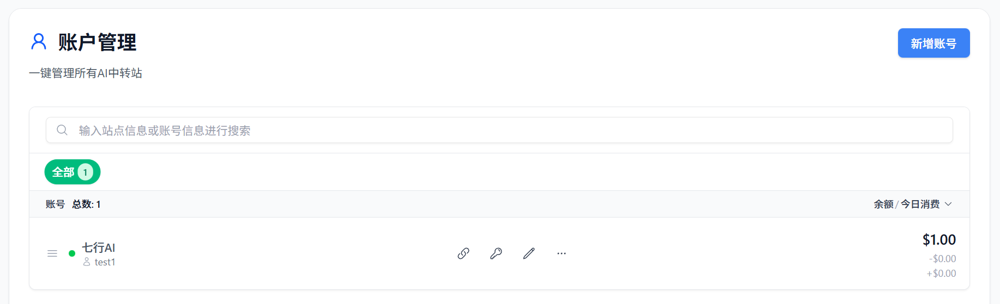
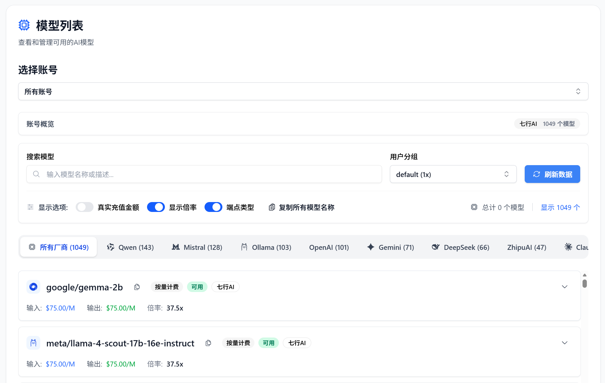
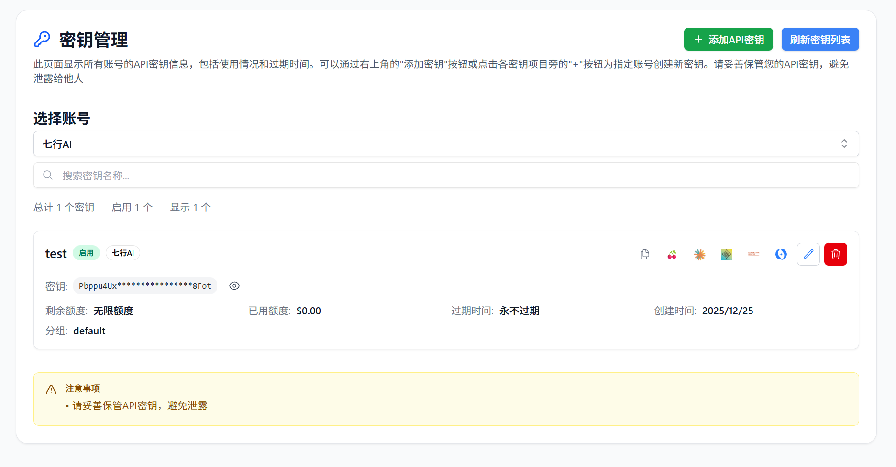
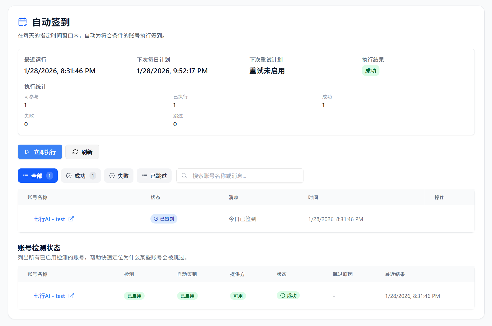
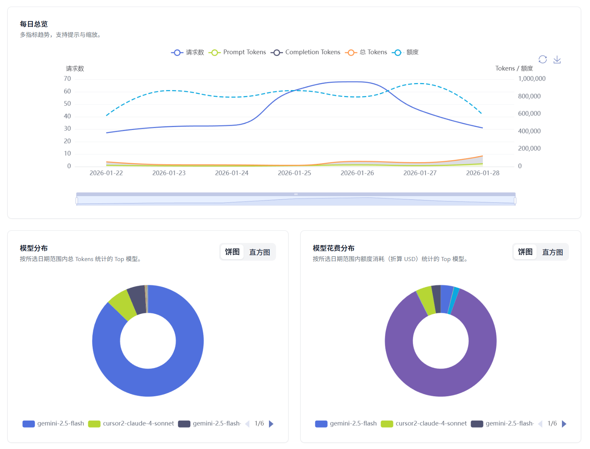
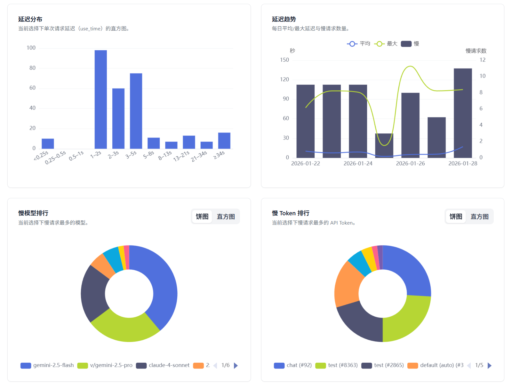
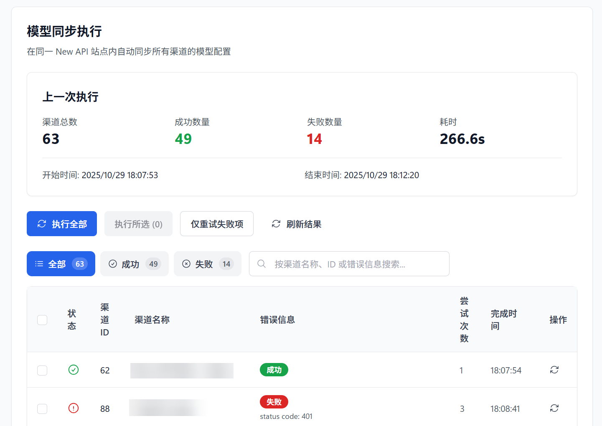
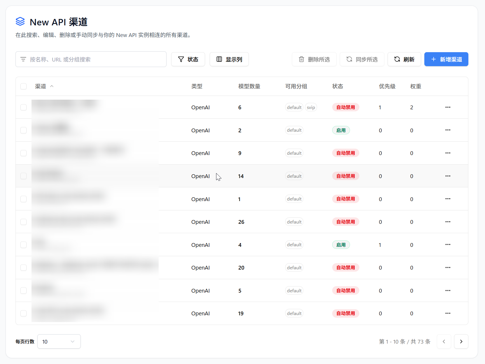

<h4 align="center">
简体中文 | <a href="./README.md">English</a> | <a href="./README_JA.md">日本語</a>
</h4>

# My API Box – 你的中转站管家

> 基于 [all-api-hub](https://github.com/qixing-jk/all-api-hub)(AGPL-3.0)修改而成,品牌为 **My API Box**;源码依同许可证开放,见 LICENSE 与 THIRD_PARTY_NOTICES.md。

**一站式管理 New API 兼容中转站账号：余额/用量、模型价格、自动签到、API 凭据、网页内测试，以及渠道与模型同步/重定向**

## ❓ 为什么需要 My API Box？

**简单来说**：AI 中转站就像“AI 充值卡超市”，能低价甚至免费使用 ChatGPT、Claude、GPT Image 等模型。

但如果你有多个账号，管理起来会很头疼：

- 📂 **资产分散**：余额和用量要逐站登录查看。
- 💲 **价格复杂**：不同站点倍率不同，难判断哪家更划算。
- ✅ **福利易漏**：每日签到送额度，但手动处理容易忘。
- 🔌 **配置繁琐**：API 信息要反复复制到 cc-switch、Cherry Studio 等工具里。

**My API Box 就是你的中转站管家**：填入站点地址，剩下的交给插件处理。

## ✨ 它能为你做什么？

### 📊 AI 资产全局掌控

- **中转站账号统一看板**：集中管理多个 AI 中转站账号，查看余额、用量与账号状态，免去逐站登录和来回切换。
- **API 凭据库**：无需绑定站点账号，把别人分享或平时零散收集的 Base URL 与 API Key 集中收好；查余额、看模型、测连接或导出，打开就能用。
- **用量与趋势统计**：记录余额变化，按站点、账号和模型查看统计图表，消耗情况一目了然。

### 💰 省钱比价与自动签到

- **跨站模型价格比对**：自动换算各站点同一模型的实际价格，快速找出更划算的调用渠道。
- **多站点自动签到**：支持一键或定时完成每日签到，自动领取签到奖励，免去每天逐站签到操作。

### 🚀 便捷录入与客户端集成

- **网页快速录入**：从网页中识别 Base URL 与 API Key，直接测试并存入 API 凭据库，减少反复复制和切换页面。
- **客户端一键导出**：将凭据快速导出至 CC Switch、Cherry Studio、Claude Code Router、Kilo Code、Roo Code、Kelivo、AI Toolbox、Cursor++ 等客户端与工具，详见 支持的导出工具。

### 🧪 接口验证与故障排查

- **API 与模型验证**：一键检测 API 连通性与模型可用性，快速判断 Key 是否有效、模型能否正常调用。
- **CLI 接入测试**：验证命令行工具能否正常使用目标 API，减少配置完成后的反复排查。

### 🔔 重要消息与任务提醒

- **公告集中查看**：自动汇总并集中展示已添加站点的各类公告消息，维护安排、模型调整、价格变动等任何动态也能及时收到提醒，无需逐站翻找。
- **任务结果通知**：自动签到、WebDAV 自动同步和模型同步等任务完成后，可通过浏览器或已配置的通知方式接收结果，遇到失败或异常也能及时处理。

### 🛠️ 自建 AI 网关集成与管理

- **主流 AI 网关统一管理**：OmniRoute、CLIProxyAPI、New API、Sub2API、Magpie、gpt-load、AxonHub、Claude Code Hub、Octopus、Veloera、DoneHub 网关都能直接在插件里管理渠道或提供商，不必逐个打开后台。
- **快速创建网关渠道**：把已保存的站点账号或 API 凭据库中的凭据快速创建为自建 AI 网关渠道，之后便能通过网关统一调用各类模型，并在不同渠道间灵活切换。
- **模型同步与重定向**：在支持的站点中，可手动或定时自动自定义同步渠道模型列表，及时跟进上游模型变化；支持自定义模型重定向规则，让客户端使用任何模型名称也能正常调用。

### 🔐 数据安全与云端同步

- **默认本地管理**：API Key、账号与设置默认保存在浏览器本地，仅在启用备份或同步时写入配置的 WebDAV 存储。
- **加密 WebDAV 自动同步**：开启加密与定时自动同步后，可在多台设备间安全传输与同步数据，更换设备也能顺畅接续使用。

## 🚀 快速安装

> [!IMPORTANT] > **绝大多数用户建议优先选择商店安装**。商店版安装简单、支持自动更新。

| 渠道         | 安装链接                                                                                        | 当前版本                                                                                                                                                                                                                                                                                                                                  | 用户数                                                                                                                                                                                                                                                                                                        |
| ------------ | ----------------------------------------------------------------------------------------------- | ----------------------------------------------------------------------------------------------------------------------------------------------------------------------------------------------------------------------------------------------------------------------------------------------------------------------------------------- | ------------------------------------------------------------------------------------------------------------------------------------------------------------------------------------------------------------------------------------------------------------------------------------------------------------- |
| 应用商店 | 上架后补充链接 | — |

📦 需要手动安装或测试版？（点击展开）

| 渠道           | 下载链接                                                                      | 适用场景                                           |
| -------------- | ----------------------------------------------------------------------------- | -------------------------------------------------- |
| GitHub Stable  | [下载 Stable](https://github.com/jinchaoqiang0311/my-api-box/releases/latest)       | 无法安装商店版，或需要临时手动安装已发布修复       |
| Nightly 预发布 | [下载 Nightly](https://github.com/jinchaoqiang0311/my-api-box/releases/tag/nightly) | 想抢先体验新功能并协助测试，可能不如商店稳定版稳定 |

GitHub Stable 和 Nightly 属于手动安装通道，不会自动更新；可 Star / Watch 仓库接收新版本通知。更多说明见 安装与更新说明。

**其他环境支持：**

- **手机端**：支持 Edge 手机版、Firefox Android、Kiwi 等浏览器，详见 移动端使用指南。
- **QQ / 360 等**：详见 手动加载指南。
- **Safari (Mac)**：需要 Xcode 编译，详详见 Safari 安装指南。

## 🧑‍🚀 30 秒上手指南

1. **安装插件**：从上方商店链接点击安装。
2. **登录站点**：在浏览器里登录你常用的 AI 中转站。
3. **点击识别**：点击插件图标 -> `新增账号` -> 输入网址 -> 点击 `自动识别`。
4. **开始享受**：查看余额、配置自动签到，或者将账号导出到你的 AI 客户端。

👉 **点击查看：更详细的图文新手教程**

### 🧩 强大的兼容性

不论你用的是哪种架构，我们基本都支持：

- **账号站点兼容架构**：[New API](https://github.com/QuantumNous/new-api)、[Sub2API](https://github.com/Wei-Shaw/sub2api)、[One API](https://github.com/songquanpeng/one-api)、[one-hub](https://github.com/MartialBE/one-hub)、[Veloera](https://github.com/Veloera/Veloera)、[VoAPI / VoAPI v2](https://github.com/VoAPI/VoAPI)、[DoneHub](https://github.com/deanxv/done-hub)、[Super-API](https://github.com/SuperAI-Api/Super-API)、API易、ModelFlare、v-api 以及 Neo-API、RIX_API 等变体。
- **自建管理后台与 AI 网关**：[OmniRoute](https://github.com/diegosouzapw/OmniRoute)、[CLIProxyAPI](https://github.com/router-for-me/CLIProxyAPI)、[New API](https://github.com/QuantumNous/new-api)、[Sub2API](https://github.com/Wei-Shaw/sub2api)、[Magpie](https://github.com/yetone/magpie)、[gpt-load](https://github.com/tbphp/gpt-load)、[AxonHub](https://github.com/looplj/axonhub)、[Claude Code Hub](https://github.com/ding113/claude-code-hub)、[Octopus](https://github.com/bestruirui/octopus)、[Veloera](https://github.com/Veloera/Veloera)、[DoneHub](https://github.com/deanxv/done-hub) 等，用于渠道或提供商管理，并按站点能力提供迁移和模型同步
  - 批量导入可将同站点密钥合并到 Magpie、New API、Octopus、gpt-load、AxonHub 普通 API key 渠道及 CLIProxyAPI OpenAI 兼容资源中，密钥调度由目标网关负责。 Magpie 还可将缺失密钥添加到同地址、同协议的已有渠道，并保留原有配置和模型设置。
- **客户端与开发工具一键导出**：CC Switch、Cherry Studio、Claude Code Router、Kilo Code、Roo Code、Kelivo、AI Toolbox、Cursor++ 等，详见 支持的导出工具
- **查看完整列表**：👉 支持的站点 与 支持的导出工具

## 🖼️ 界面预览

<table>
  <tr>
    <td align="center">
      
      
账户管理总览

    </td>
    <td align="center">
      
      
模型列表与价格

    </td>
  </tr>
  <tr>
    <td align="center">
      
      
密钥列表与导出

    </td>
    <td align="center">
      
      
账号自动签到

    </td>
  </tr>
  <tr>
    <td align="center">
      
      
账号模型使用情况

    </td>
    <td align="center">
      
      
模型慢查询分析

    </td>
  </tr>
  <tr>
    <td align="center">
      
      
New API 模型同步

    </td>
    <td align="center">
      
      
New API 渠道管理

    </td>
  </tr>
</table>

## 🛠️ 开发指南

请参阅 [CONTRIBUTING](CONTRIBUTING.md) 以获取更多信息。

## 📜 许可证与商业授权

My API Box 基于 GNU Affero General Public License v3.0（AGPL-3.0）开源。

商业授权联系：the upstream author (see the all-api-hub repository)

商业授权仅覆盖 My API Box 维护者有权授权的代码和资源。第三方依赖以及历史上源自 [One API Hub](https://github.com/fxaxg/one-api-hub) 的 MIT 许可部分，仍需保留对应版权与许可声明，详见 [THIRD_PARTY_NOTICES.md](THIRD_PARTY_NOTICES.md)。

## 🏗️ 技术栈

- **框架**: [WXT](https://wxt.dev) 负责多浏览器扩展工具链与构建流程
- **UI 层**: [React](https://react.dev) 构建扩展选项页与弹窗界面
- **语言**: [TypeScript](https://www.typescriptlang.org) 提供端到端的类型安全
- **样式**: [Tailwind CSS](https://tailwindcss.com) 以原子化工具类驱动主题样式
- **组件**: [Radix UI](https://www.radix-ui.com/) 提供可访问组件与设计系统基石

## 🔗 生态项目

围绕 My API Box 的社区扩展与集成项目：

| 项目                                                        | 说明                       | 功能                                                                |
| ----------------------------------------------------------- | -------------------------- | ------------------------------------------------------------------- |
| [Metapi](https://github.com/cita-777/metapi)                | 自托管元聚合网关           | 将多个中转站账号汇聚到一个 API 入口；项目最初灵感来自 My API Box。 |
| [Fl API Hub](https://github.com/RebornQ/fl_api_hub)         | 跨平台原生管理客户端       | 管理账号、余额和密钥，支持快速签到；项目灵感来自 My API Box。      |
| [APIManager](https://github.com/zhalice2011/api-manager)    | 本地 AI API 聚合代理管理器 | 从 My API Box 同步账号，并提供统一代理、路由与用量看板。           |

> 如果你开发了基于 My API Box、与其集成或受其启发的项目，欢迎提交 PR 将其添加到此列表。

## 🙏 致谢

- [WXT](https://wxt.dev) - 现代化的浏览器扩展开发框架

  <strong>⭐ 如果这个项目对你有帮助，请考虑给它一个星标！</strong>

