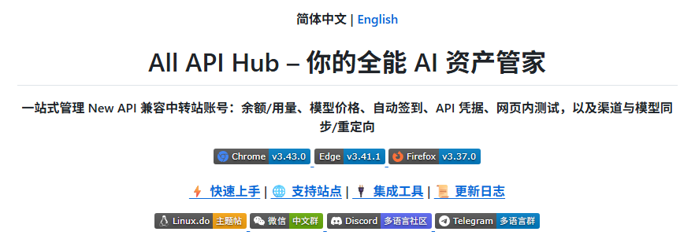
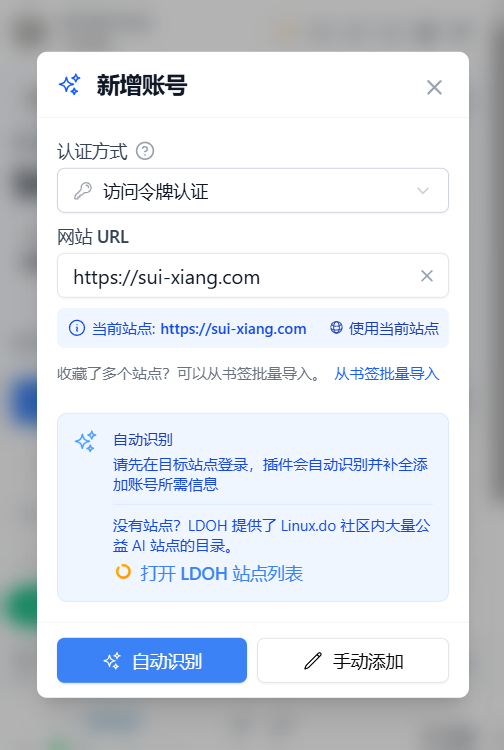
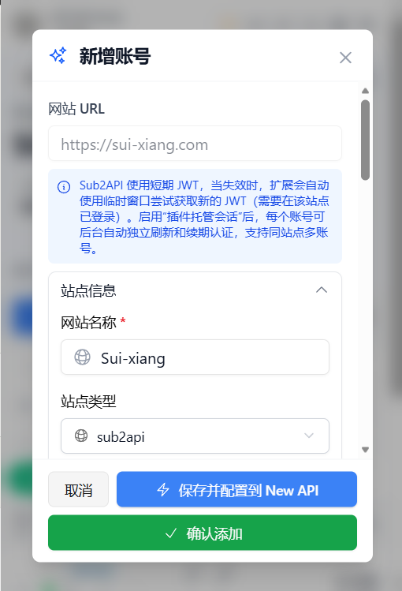
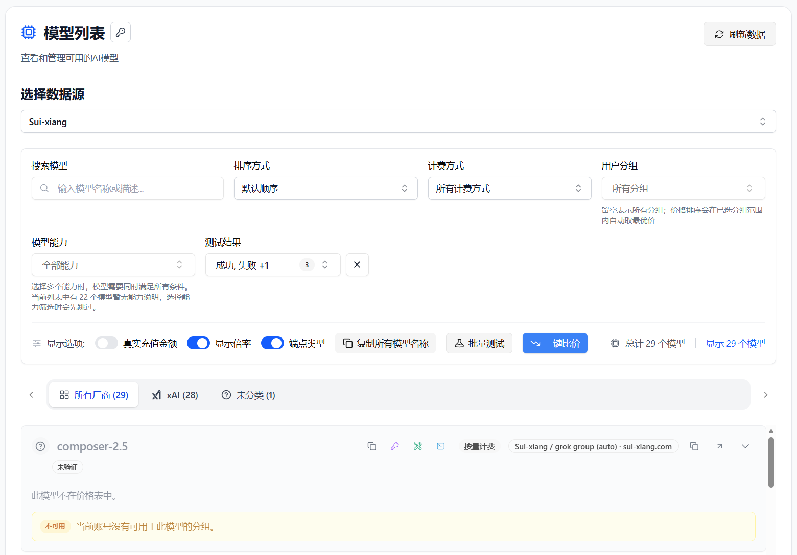
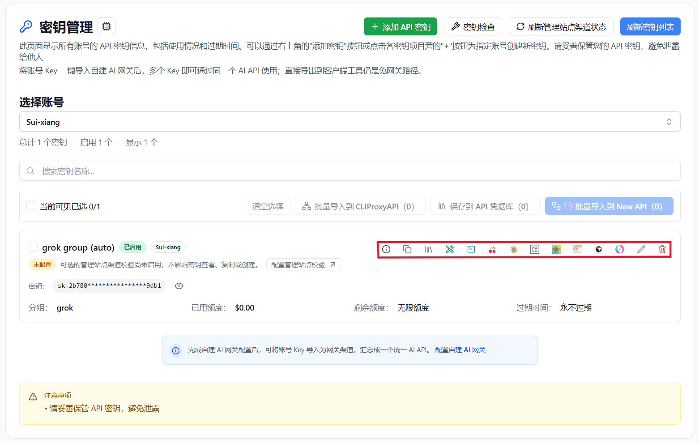

# Manage Suixiang AI Relay with My API Box

> Use My API Box with Suixiang AI Relay to check balances, compare model pricing, manage API keys, and export credentials to the AI tools you use.

Suixiang AI Relay provides Claude, Codex, Gemini, and other API relay services, with pay-as-you-go billing, daily sign-in credits, multiple routes, and automatic failover. If you use multiple Suixiang accounts, several AI API platforms, or different clients, **My API Box** gives you one local place to manage and reuse them.

After adding a Suixiang account, you can view balances, manage API keys, check model pricing, and export credentials to Cherry Studio, CC Switch, Kilo Code, Claude Code Router, or a self-hosted gateway such as CLIProxyAPI, New API, or Sub2API.

---

## 1. What My API Box Does

**My API Box** ([open source on GitHub](https://github.com/qixing-jk/all-api-hub)) is a browser extension for managing multiple AI API accounts, sites, and client configurations. For Suixiang users, it brings account status, API keys, model pricing, and export actions into one workflow.

When used with Suixiang, it helps with:

- **Unified multi-account dashboard**: view Suixiang alongside other AI API accounts.
- **Cross-account price comparison**: compare Suixiang model prices with other added accounts.
- **Centralized API key management**: view, create, edit, delete, and copy Suixiang keys.
- **Credential reuse**: export managed `Base URL + API Key` values to clients, CLI tools, or self-hosted channels.
- **Multi-device continuity**: move common configuration with import/export or WebDAV sync.

Suixiang provides the model API, while My API Box organizes accounts, keys, pricing, and downstream tool configuration.

---

## 2. Install My API Box

Install from the official store for your browser when possible: [Chrome Web Store](https://chromewebstore.google.com/detail/YOUR-CHROME-EXTENSION-ID), [Microsoft Edge Add-ons](https://microsoftedge.microsoft.com/addons/detail/YOUR-EDGE-EXTENSION-ID), or [Firefox Add-ons](https://addons.mozilla.org/firefox/addon/{YOUR-AMO-SLUG}). For other browsers, Safari, mobile browsers, or a manual installation, use the [installation guides](../get-started.md) and [GitHub Releases](https://github.com/qixing-jk/all-api-hub/releases/latest).

---

## 3. Add a Suixiang Account

My API Box can auto-recognize Suixiang accounts. Log in to Suixiang in your browser first, then let the extension read the current site and save the account.

### 3.1 Auto-recognize and add

1. Log in to [Suixiang AI Relay](https://sui-xiang.com/) in your browser.
2. Click the My API Box extension icon.
3. Click **Add Account**, then use the current site address or enter the Suixiang address manually.

   

4. Click **Auto-Recognize**.
5. Confirm the account information and click **Save Account**.

   

:::: tip
After the account is saved, the extension uses the imported token to read balance, API keys, and model pricing information.
::::

### 3.2 Manage Suixiang API keys

Open **Key Management** after adding the account. You can view existing keys, create, edit, delete, and copy keys, save them to **API Credential Profiles**, and export them whenever another tool needs the credential.

---

## 4. Common Suixiang Workflows

### 4.1 View balance and account status

The My API Box dashboard shows Suixiang alongside your other AI API accounts. Balance, status, and refresh results are shown in one place.

### 4.2 Compare model pricing

Open **Model Pricing** and select the Suixiang account. You can view its model list, search for a model, test availability, check input/output pricing, and compare prices with other accounts.

### 4.3 Export to AI clients

1. Find your Suixiang key in **Key Management**.
2. Choose an export action.
3. Select **Cherry Studio**, **CC Switch**, **Kilo Code**, **Claude Code Router**, or a configured self-hosted channel.

You can also copy `Base URL + API Key`, verify API or CLI compatibility, view available models, export to multiple clients, import into a self-hosted site, and move credentials with data import/export or WebDAV sync.

::: warning Credential transfer scope
Browser local storage is only the default save location. Exporting, self-hosted imports, API or CLI tests, and WebDAV sync send credentials to the corresponding destination. Only send keys to destinations you trust, and revoke them when no longer needed.
:::

### 4.4 Import into a self-hosted channel

If you maintain a self-hosted gateway such as CLIProxyAPI, New API, or Sub2API, you can use Suixiang as an upstream provider. Configure your backend under **Basic Settings -> Self-hosted Site Management**, then return to **Key Management** and import the Suixiang key into the current site. Multiple keys can be imported in bulk.

### 4.5 Move between devices and back up

Data stays in the current browser by default. Use data import/export or explicitly configured WebDAV sync to move configuration between computers.

---

## 5. My API Box vs. API Clients

| Area | My API Box (Management) | Cherry Studio / NextChat and Similar Clients |
| --- | --- | --- |
| Core role | Manage Suixiang and other AI API accounts, balances, keys, pricing, and channels | Send chats, run inference, and manage prompts or agent workflows |
| Main actions | Dashboard, key management, price comparison, credential export, and channel import | Chat, file analysis, and agent workflows |
| Relationship | Organizes source configuration | Uses managed credentials to call models |

Recommended workflow: manage Suixiang accounts, keys, pricing, and exports in My API Box, then use your preferred client to send requests.

---

## 6. FAQ

**Q: Does My API Box upload my API key?**

A: By default, account and key data stays in your local browser. Exporting, self-hosted imports, API or CLI tests, and WebDAV sync send credentials to their corresponding destinations. Only send keys to destinations you trust, and revoke them when no longer needed.

**Q: Who is this best suited for?**

A: It is useful if you have multiple Suixiang accounts, use other AI API platforms, or configure Suixiang in several clients and devices.

**Q: Can I use it without a self-hosted backend?**

A: Yes. Add a Suixiang account to use balance checks, key management, pricing comparison, and client export.

**Q: Will exported clients continue to work independently?**

A: Yes. My API Box only generates or fills configuration; the target client performs the actual model calls.

**Q: What is the relationship with the Suixiang console?**

A: They work together. The Suixiang console remains the source for account, recharge, and official service operations. My API Box is for day-to-day account status, API keys, pricing, and client configuration.

---

## Links

- [Suixiang AI Relay](https://sui-xiang.com/)
- [My API Box GitHub repository](https://github.com/qixing-jk/all-api-hub)
- [My API Box documentation](https://all-api-hub.qixing1217.top/en/)
