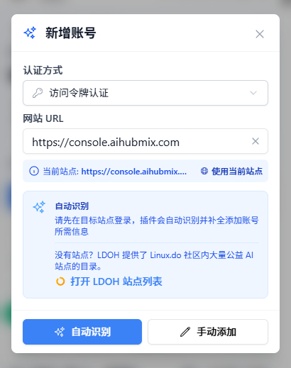
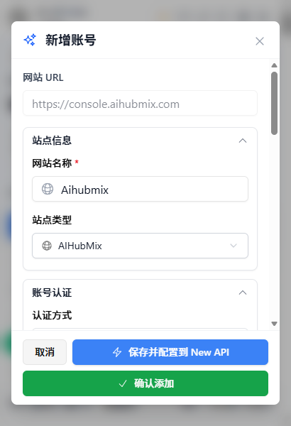
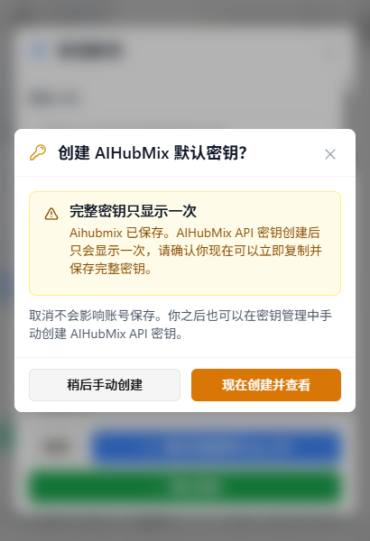
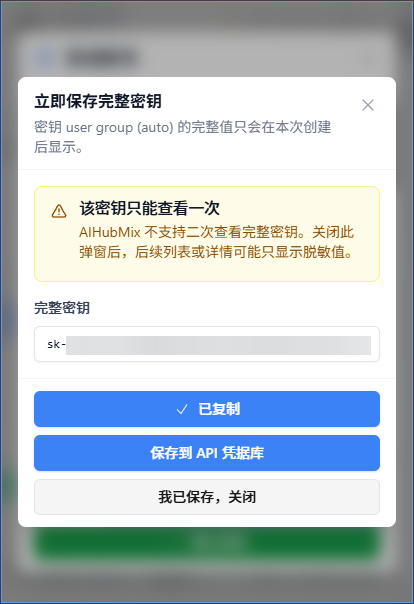
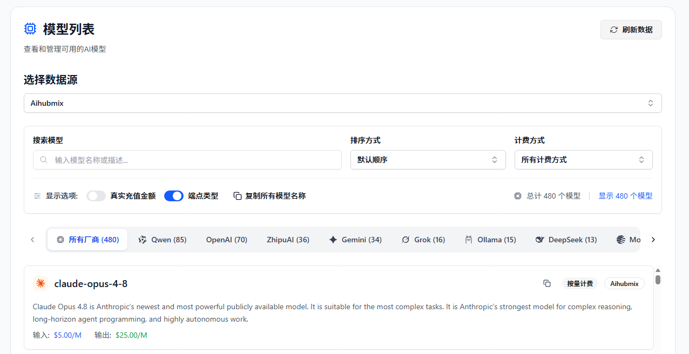
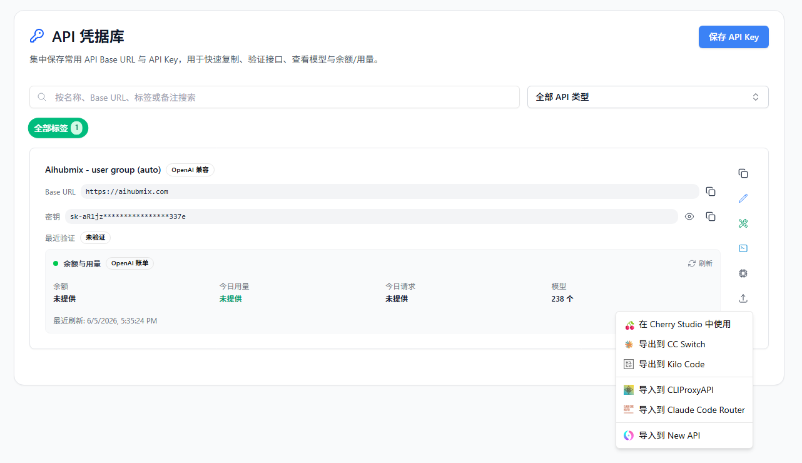

# AIHubMix の API キーとモデル価格を My API Box で管理する

> AIHubMix と My API Box を組み合わせて、アカウント残高、API キー、モデル価格を管理し、保存済みの認証情報を他の AI ツールで再利用します。

**My API Box** は AI API ユーザー向けのオープンソースブラウザ拡張機能です。AIHubMix と組み合わせると、アカウント残高、API キー、モデル一覧、価格情報を管理でき、一度だけ表示される完全な API キーも作成時に保存できます。

---

## 1. My API Box でできること

複数の AI モデルや API プラットフォームを使うと、残高、キー、価格情報が分散しがちです。**My API Box**（[GitHub で公開](https://github.com/qixing-jk/all-api-hub)）は、これらの情報をローカルで一元管理する入口を提供します。

AIHubMix ユーザーには、次の用途があります。

- **残高確認**：拡張機能パネルから AIHubMix の残高を確認できます。
- **API キー保護**：AIHubMix の完全なキーは一度だけ表示されます。My API Box は作成時に完全なキーを **API 認証情報プロファイル** に保存できます。
- **モデル価格確認**：AIHubMix のモデル一覧と入力 / 出力価格を確認できます。
- **認証情報エクスポート**：保存済みのキーを Cherry Studio、CC Switch、Kilo Code、Claude Code Router などへエクスポートできます。

---

## 2. My API Box をインストールする

自動更新と安定した利用のため、可能であれば利用中のブラウザに対応した公式ストアからインストールしてください。

- **Chrome**：[Chrome ウェブストア](https://chromewebstore.google.com/detail/YOUR-CHROME-EXTENSION-ID)
- **Edge**：[Microsoft Edge Add-ons](https://microsoftedge.microsoft.com/addons/detail/YOUR-EDGE-EXTENSION-ID)
- **Firefox**：[Firefox Add-ons](https://addons.mozilla.org/firefox/addon/{YOUR-AMO-SLUG})
- **QQ / 360 / Brave / Vivaldi / Opera など**：Brave、Vivaldi、Opera は通常まず Chrome ウェブストアを試せます。QQ、360、チーターブラウザなどは利用可能なストア経路がない場合、Chromium の手動読み込みを使えます。詳しくは [その他のブラウザへのインストールガイド](../other-browser-install.md) を参照してください。
- **Mac の Safari**：[Safari インストールガイド](../safari-install.md) を参照してください。
- **モバイルブラウザ**：[モバイルブラウザ FAQ](../faq.md#mobile-browser-support) を参照してください。
- **代替手段**：ブラウザがストア版または Chrome ウェブストア互換版を利用できず、上記ガイドでも解決しない場合は、[GitHub Releases](https://github.com/qixing-jk/all-api-hub/releases/latest) から Stable パッケージをダウンロードできます。手動インストール版は自動更新されません。

---

## 3. AIHubMix アカウントを追加する

My API Box は、複雑な手動設定なしで AIHubMix アカウントを自動認識して追加できます。

AIHubMix は多くのモデルを提供しているため、利用前にモデル名、価格、現在のツールに適しているかを確認したいことがあります。また、AIHubMix の API キーは作成後に一度だけ表示されるため、すぐ保存しないと再作成が必要になる場合があります。

My API Box は、主に次の 2 つの流れを支援します。

- アカウント追加後、残高とモデル価格をまとめて確認する。
- キー作成後、完全な Key をすぐ保存し、後からコピー、検証、エクスポートできるようにする。

### 3.1 自動認識で追加する

1. ブラウザで [AIHubMix コンソール](https://console.aihubmix.com/?aff=W3DN) にログインします。
2. ブラウザ右上の My API Box 拡張機能アイコンをクリックします。
3. **アカウントを追加** をクリックし、現在のサイトアドレスを使うか AIHubMix のアドレスを手動入力します。

   

4. **自動認識** をクリックします。拡張機能が `AIHubMix` のアカウント種別を識別します。
5. アカウント情報を確認し、**アカウントを保存** をクリックします。

   

:::: tip
保存後、拡張機能はインポートされたアカウントトークンを使って残高、API キー、モデル価格などを読み取ります。
::::

### 3.2 一度だけ表示される完全な API キーを保存する

AIHubMix の完全な API キーは作成後に再表示されないため、My API Box は専用の保存フローを用意しています。

1. **アカウント保存後の確認**：アカウント追加後、拡張機能がデフォルトキーをすぐ作成するか確認します。

   

2. **今すぐ作成して表示**：**今すぐ作成して表示** をクリックすると、新しいキーが生成され、完全なキーのウィンドウが開きます。
3. **API 認証情報プロファイルへ保存**：**API 認証情報プロファイルに保存** をクリックすると、キーがブラウザ内に保存され、後からコピー、検証、エクスポートできます。

   

---

## 4. 主な使い方

### 4.1 残高とアカウント状態を確認する

My API Box のダッシュボードでは、AIHubMix のアカウント状態と残高を確認できます。更新に失敗した場合や確認が必要な場合は、アカウントカードに状態が表示されます。

### 4.2 モデル価格を確認する

**モデル価格** を開き、AIHubMix アカウントをデータソースとして選択します。次の操作ができます。

- AIHubMix が返すモデル一覧を確認する。
- 入力 / 出力価格を確認する。該当する場合、1M tokens あたりの米ドル価格として表示されます。
- 他のツールへ設定する前に、特定モデルを検索して確認する。

### 4.3 AI クライアントへエクスポートする

AIHubMix を他のツールで使う場合は、次の流れでエクスポートできます。

1. **API 認証情報プロファイル** で保存済みの AIHubMix キーを見つけます。
2. 必要なエクスポート操作を選択します。
3. **Cherry Studio**、**CC Switch**、**Kilo Code**、**Claude Code Router**、または設定済みのセルフホスト型サイトを選びます。

API 認証情報プロファイルに保存した後は、`Base URL + API Key` のコピー、疎通確認、利用可能モデル一覧の確認、複数クライアントへのエクスポート、CLIProxyAPI、New API、Sub2API などの設定済みセルフホスト型ゲートウェイへのインポート、インポート / エクスポートや WebDAV 同期による移行もできます。

---

## 5. My API Box と API クライアントの違い

| 項目 | My API Box（管理側） | Cherry Studio / NextChat など（利用側） |
| --- | --- | --- |
| 主な役割 | アカウント、残高、キー、価格を管理する | チャット、推論、プロンプトや Agent ワークフローを実行する |
| 主な操作 | ダッシュボード、キー保存、価格確認、認証情報エクスポート | チャット、ファイル分析、Agent ワークフロー |
| 関係 | API キーや価格などの元設定を管理する | My API Box で管理した認証情報を使う |

おすすめの使い方は、My API Box でアカウント、キー、価格情報を管理し、実際のリクエストは普段使っているクライアントから送ることです。

---

## 6. FAQ

**Q: My API Box は API キーをアップロードしますか？**

A: 既定では、アカウントとキーの情報はブラウザ内に保存されます。WebDAV 同期を明示的に有効化し、自分の WebDAV ストレージを設定した場合のみ同期されます。

**Q: アカウント追加後、一部のモデルが表示されないのはなぜですか？**

A: My API Box は AIHubMix API が返すモデルデータを表示します。アカウントごとの利用可能範囲を確認できない場合、完全なモデルカタログにフォールバックし、現在のアカウントでは一部モデルを呼び出せない可能性を示すことがあります。

**Q: 以前作成した AIHubMix キーを復元できますか？**

A: AIHubMix の完全なキーは通常一度だけ表示されます。作成時に API 認証情報プロファイルへ保存していない場合、My API Box は後から復元できません。AIHubMix で新しいキーを作成し、完全なキーが表示されている間に保存してください。

**Q: My API Box は AIHubMix コンソールの代わりになりますか？**

A: いいえ。チャージ、アカウント設定、公式キー作成などは引き続き AIHubMix コンソールで行います。My API Box は日常的な残高確認、キー保存、認証情報エクスポートに向いています。

---

## リンク

- [AIHubMix](https://aihubmix.com/?aff=W3DN)
- [My API Box GitHub リポジトリ](https://github.com/qixing-jk/all-api-hub)
- [My API Box ドキュメント](https://all-api-hub.qixing1217.top/ja/)
